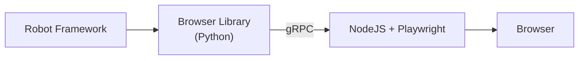
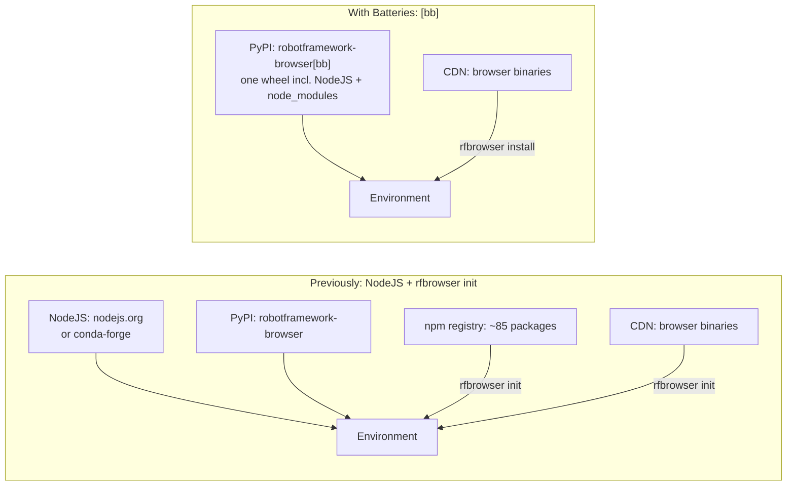

Until recently, I hadn’t heard of the “Browser-Batteries” package. *Why on earth would I install Node.js via a Python package when I can install it myself?*

If you have the same question in mind, or have never heard of "Batteries", read on.  

In this article I have put together what the Batteries package is and when you should use it.

<!--more-->

## Background: why NodeJS in the first place?

Unlike many other libraries for Robot Framework, the [Browser Library](https://robotframework-browser.org) is not a pure Python package.

The library's keywords (`Fill Text` or `Click`, for example) are written in Python; the actual control of the browser, however, is handled by [Playwright](https://playwright.dev) — a NodeJS library.  

Between the two worlds runs a NodeJS process that the library addresses via **gRPC**:



That has consequences for the environment: to use the Browser Library, you need a NodeJS runtime and the packages that go with it.  
Together with the browser binaries, this easily adds up to more than 700 MB.

> **Info:** gRPC (Google Remote Procedure Call) is a protocol for calls between processes. As a user, it stays in the background for you. This is the channel through which a `Click` on the Python side is, so to speak, "translated" into a Playwright call on the NodeJS side.

So two things have to be present on a test host:

1. a NodeJS runtime
2. Playwright's NodeJS packages

How you provide the two of them depends on how you manage your environment.

### The standard method: pip and `rfbrowser init`

There are many ways to create virtual Python environments: `venv`, `virtualenv`, `conda` or `uv`.  

With all these options, the procedure for the browser library has so far been the same: Node.js must be installed on the system, and then you run `rfbrowser init`.
`npm` then takes care of installing the Node.js packages, as well as installing the browsers. 

Here is an example of manual installation in a `venv`:

```bash
pip install robotframework-browser
rfbrowser init chromium
```

### The Robotmk Way: RCC and `conda.yaml`

With Robotmk, [RCC]() builds the runtime environment itself, based on a declaration.  

NodeJS is not installed system-wide, but is part of the environment described in `conda.yaml`:

```yaml
dependencies:
  - python=3.12
  - pip=23.2.1
  - nodejs>=26.13
  - pip:
      - robotframework>=7.5
      - robotframework-browser>=21.0
rccPostInstall:
  - rfbrowser init chromium
```

`rfbrowser init` then fetches the Node.js packages and the browsers here as well.

## The new variant: Browser Batteries

Since version 19.9, every major version of the Browser Library has a matching "wheel" package that brings along the NodeJS runtime and the Playwright packages.

> **Info:** A "wheel" is a Python package format that simplifies the installation of packages. It already contains compiled files and dependencies, so that no additional installation steps are necessary.

For the **standard way** this means: two commands, and NodeJS no longer has to be present on the system at all.

```bash
pip install robotframework-browser[bb]
rfbrowser install chromium
```

For the **Robotmk way**, the extra moves into the `conda.yaml`:

```yaml
dependencies:
  - python=3.12
  - pip=23.2.1
  - pip:
      - robotframework>=7.5  
      - robotframework-browser[bb]>=21.0
rccPostInstall:
  - rfbrowser install chromium
```

Three things have changed compared to the previous variant:

- `robotframework-browser[bb]`: the `[bb]` extra installs the Python part as before, but pulls in the matching Batteries wheel as well.
- `rfbrowser install`: the command is no longer called `init`, but `install`. The reason: `init` used to install the NodeJS dependencies *and* the browser binaries; `install` only has to download the browsers, since the NodeJS side is already in place.
- **NodeJS as a separate ingredient is gone.** In the standard way you no longer need it on the system; in the `conda.yaml` the `nodejs=` line even **has to go**. If you leave it in, you end up with two NodeJS runtimes in the environment, getting in each other's way. Batteries brings along the version that fits.




## The comparison

I compared both variants in terms of installation and disk space.

### Disk space


|                    | NodeJS separately + `rfbrowser init`    | `[bb]` wheel              |
| ------------------ | --------------------------------------- | ------------------------- |
| NodeJS runtime     | 99.9 MB                                 | 95.5 MB                   |
| npm + corepack     | 12.0 MB (1,926 files)                   | not included              |
| `node_modules`     | ~33.9 MB (~2,844 files)                 | 33.9 MB (2,844 files)     |
| **on disk**        | **~146 MB, ~4,780 files**               | **130.7 MB, 2,853 files** |
| Download           | 34.5 MB + ~85 npm tarballs              | 45.4 MB, one wheel        |

(Measured against the conda-forge package `nodejs` 26.10.0 and the Batteries wheel 21.0.0, both for Windows x64. A NodeJS from nodejs.org is in the same ballpark.)

The saving is exactly the npm footprint: **a mere 15 MB.**  

➡️ Disk space is not an argument, in either direction.

### Installation

The last row of the table holds several advantages at once:

#### Fewer files, fewer downloads

- Without Batteries, the host downloads one NodeJS package **and** around 85 packages from the npm registry.  
- With Batteries, it downloads one (1) file.

➡️ That is not only faster, it is also one target on the internet less that may have to be whitelisted.

#### Proxy settings and TLS inspection

In the article [Understanding and Applying Proxy Settings]() I have already described how much fun one can have with proxies ...

`npm` is a discipline of its own in this respect: `.npmrc`, `strict-ssl`, `cafile`, `NODE_EXTRA_CA_CERTS` – and it shares none of this with pip or conda.

In the Batteries wheel, by contrast, `npm` is not included at all, simply because it is not needed: the browser download runs via the bundled Node, not via `npx`.

➡️ Simpler setup, fewer pitfalls.

#### Guaranteed NodeJS version

I have been asked by customers more than once which NodeJS version is the right one.  
My honest answer is: "I don't know", because I believe it does not matter.  

Even so, with "Batteries" you have the certainty that the correct NodeJS version is being used.

➡️ An entire category of errors disappears


## What you should keep in mind

None of this comes for free. Three points you should check beforehand:

- **Older platforms drop out:** the wheels are built for **glibc 2.28** (found on Debian 10, RHEL 8, Ubuntu 20.04), Windows 10 / Server 2016 and macOS 13.5. Below that, you will not get the package to run.
- **Version lockstep:** the Batteries package ties `robotframework-browser` in *exactly* one version to one NodeJS version. Upgrading one of them on its own is not possible. (Not that you really need to – I just want to have mentioned it.)
- **Responsibility shifts** from nodejs.org or conda-forge **to PyPI**, and with it to the package maintainer of the Browser Library.


## What this means for the supply chain

The following points are only relevant if you consider the article [RCC Environments and their Supply Chain]() to be of significance.

**Before:** by way of the `package-lock.json` file, with exact versions and checksums, the supply chain could be checked down to the individual package at any time.

**With Batteries**, the situation shifts:

- **The upside:** the NodeJS side becomes a single pip-versioned package and therefore lands in RCC's **freeze file** and in the [grace period check]() – where the npm tree never showed up before.
- **Worth noting:** instead of 84 checksums that npm verifies individually against the lockfile, you now only verify a single wheel hash against PyPI. (The evidence does remain available, though, because the lockfile travels inside the wheel.)

For the **browser binaries**, Batteries changes nothing – they still come from a CDN without any checksum comparison.

## Conclusion

So we can conclude: Browser Batteries is not a disk-space optimisation, but rather an **installation optimisation**. It removes npm as the third package manager from the chain, and with it the most fragile step in installing the Browser Library.

At **Robotmk**, this is important: there, that step does not run once but on every monitored host, and again with every rebuild of the environment.

On a development machine with open internet access you will hardly notice anything beyond a shorter build time.

In a corporate network with a proxy, TLS inspection and a virus scanner, things certainly look different again.

If you have experience or an opinion on this, I would be glad to see a comment below the article.
